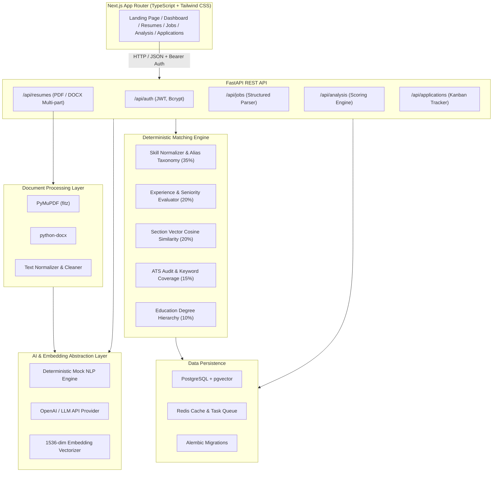

# ResumeIQ — AI Resume Analyzer & Job Matcher

[](https://resumeiq-app.onrender.com)
[](https://github.com/thottadijaswanth/ResumeIQ/actions)
[](https://fastapi.tiangolo.com)
[](https://nextjs.org)
[](https://www.postgresql.org)
[](https://python.org)
[](https://www.typescriptlang.org)

> **Live Application:** **[https://resumeiq-app.onrender.com](https://resumeiq-app.onrender.com)**  
> *(Hosted on Render Free Tier — if the service was idle for 15+ minutes, the initial load takes ~30–60 seconds to wake up.)*

**ResumeIQ** is a production-grade full-stack web application designed for recruiters and engineers to screen bulk resumes against structured jobs, compute transparent deterministic match scores with timeline-verified experience checks, audit ATS compatibility, perform semantic vector search, and run optional AI reranking (OpenAI-compatible cloud AI or local Ollama `qwen3:1.7b`).

---

## Architecture Overview



---

## Key Features

1. **Deterministic 5-Pillar Scoring Model**:
   - **Skills Match (35%)**: Canonical alias mapping (e.g., *Postgres* / *PostgreSQL DB* → *PostgreSQL*) differentiating required vs. preferred qualifications.
   - **Experience Alignment (20%)**: Candidate work duration and role level versus job requirements.
   - **Semantic Similarity (20%)**: Section-level chunking and cosine similarity comparison across 1536 dimensions.
   - **Keywords & ATS (15%)**: Real keyword frequency, quantifiable achievement counts, and action verb density.
   - **Education (10%)**: Degree hierarchy validation (B.S., M.S., Ph.D.).

2. **ATS Compatibility Scanner**:
   - Section completeness checklist (Contact, Summary, Experience, Education, Skills, Projects).
   - Numerical achievement detection (percentages, latencies, user scale).
   - Keyword stuffing and over-optimization detection.
   - Formatting risk alerts.

3. **Zero-Hallucination Resume Tailoring**:
   - Customizes candidate resumes to highlight role-relevant bullet points and skills.
   - Strict rule enforcement: **never** invents employment history, companies, dates, degrees, or metrics.

4. **Tailored Cover Letter Generator**:
   - Generates personalized letters referencing the candidate's real accomplishments and target company objectives.
   - Configurable tone (*Professional*, *Confident*, *Enthusiastic*).

5. **Job Application Pipeline Tracker**:
   - Interactive Kanban tracker supporting *Saved*, *Applied*, *Interview*, *Offer*, and *Rejected* statuses.
   - Integrated match score badges and application notes.

---

## Tech Stack

- **Frontend**: Next.js 14 (App Router), TypeScript, React 18, Tailwind CSS, Lucide Icons, Recharts.
- **Backend**: Python 3.12, FastAPI, Pydantic V2, SQLAlchemy 2.0, Alembic.
- **Document Processing**: PyMuPDF (`fitz`), `python-docx`.
- **Database & Storage**: PostgreSQL 16 with `pgvector`, Redis 7.
- **Authentication**: JWT with Bearer tokens, Bcrypt password hashing.
- **Infrastructure**: Docker, Docker Compose, GitHub Actions CI/CD.

---

## Project Structure

```
ResumeIQ/
├── frontend/
│   ├── app/
│   │   ├── page.tsx               # SaaS Landing Page
│   │   ├── layout.tsx             # Root Layout with Navbar & Footer
│   │   ├── login/page.tsx         # User Login
│   │   ├── register/page.tsx      # User Registration
│   │   ├── dashboard/page.tsx     # Metrics Dashboard & Recent Analyses
│   │   ├── resumes/page.tsx       # Resume Upload & Structured Viewer
│   │   ├── jobs/page.tsx          # Job Description Requirement Extractor
│   │   ├── analysis/[id]/page.tsx # Centerpiece Match Report & Tailoring
│   │   └── applications/page.tsx  # Kanban Application Tracker
│   ├── components/                # Reusable UI Components
│   ├── lib/                       # API Client & Utility Functions
│   └── types/                     # TypeScript Interfaces
│
├── backend/
│   ├── app/
│   │   ├── main.py                # FastAPI Application Entrypoint
│   │   ├── config.py              # Pydantic Settings
│   │   ├── api/                   # REST Endpoints (auth, resumes, jobs, analysis, etc.)
│   │   ├── models/                # SQLAlchemy Relational Models
│   │   ├── schemas/               # Pydantic V2 Request & Response Schemas
│   │   ├── services/              # Business Logic Services
│   │   ├── repositories/          # Database Repository Data Access Layer
│   │   ├── ai/                    # AI Provider Abstraction (Mock, OpenAI, Embeddings)
│   │   ├── document_processing/   # PyMuPDF and python-docx Parsers
│   │   ├── matching/              # Deterministic Scoring & Semantic Matching Engine
│   │   └── utils/                 # Security, JWT, Logging
│   ├── alembic/                   # Database Migrations
│   └── tests/                     # Pytest Unit & Integration Test Suite
│
├── docker/                        # Backend and Frontend Dockerfiles
├── scripts/                       # Database Seeding Scripts
├── .github/workflows/             # CI/CD Pipeline
├── docker-compose.yml             # Local Multi-Container Composition
└── README.md
```

---

## Local Development Setup

### Prerequisites

- **Python 3.12+**
- **Node.js 20+** and **npm**
- **Docker & Docker Compose** (optional for containerized deployment)

### 1. Clone & Environment Configuration

```bash
cp .env.example backend/.env
cp .env.example frontend/.env.local
```

### 2. Backend Setup

```bash
cd backend

# Create and activate virtual environment
python -m venv venv
# On Windows:
.\venv\Scripts\activate
# On macOS / Linux:
source venv/bin/activate

# Install dependencies
pip install --upgrade pip
pip install -r requirements.txt
pip install "email-validator>=2.0.0"

# Run database migrations
alembic upgrade head

# Start FastAPI server
uvicorn backend.app.main:app --reload --port 8000
```

The interactive API documentation is accessible at:
- **Swagger UI**: [http://localhost:8000/api/docs](http://localhost:8000/api/docs)
- **ReDoc**: [http://localhost:8000/api/redoc](http://localhost:8000/api/redoc)

### 3. Frontend Setup

In a new terminal:

```bash
cd frontend

# Install packages
npm install

# Start Next.js development server
npm run dev
```

Open [http://localhost:3000](http://localhost:3000) in your browser.

---

## Seeding Synthetic Demo Data

To populate the application with a realistic synthetic profile:

```bash
.\backend\venv\Scripts\python scripts/seed_demo_data.py
```

Demo account credentials:
- **Email**: `demo@resumeiq.io`
- **Password**: `DemoPassword123!`

---

## Running Automated Tests

ResumeIQ includes a full unit and integration test suite covering authentication, document extraction, skill taxonomy normalization, deterministic score calculation, and end-to-end workflows.

```bash
# Run pytest with verbose reporting
.\backend\venv\Scripts\python -m pytest backend/tests -v
```

All 16 test cases pass out of the box with zero external API dependencies.

---

## Docker Deployment

To build and run the entire stack (PostgreSQL + pgvector, Redis, FastAPI backend, Next.js frontend) with a single command:

```bash
docker compose up --build
```

- **Frontend**: [http://localhost:3000](http://localhost:3000)
- **Backend API**: [http://localhost:8000/health](http://localhost:8000/health)

---

## CI/CD Pipeline

The GitHub Actions workflow (`.github/workflows/ci.yml`) runs on every pull request and push to `main`:
1. **Backend Job**: Checks syntax, installs dependencies, and runs the Pytest test suite.
2. **Frontend Job**: Verifies TypeScript types and creates an optimized Next.js production build.
3. **Docker Build Job**: Validates that production Docker containers build cleanly.

---

## AI Provider Architecture (Local Ollama vs. Cloud OpenAI-Compatible)

ResumeIQ separates its AI reasoning layer (`BaseAIProvider`), semantic retrieval (`BaseEmbeddingProvider`), and deterministic 5-pillar scoring engine (`ScoringEngine`). You can switch between completely offline local execution and cloud deployment purely through environment variables—no code changes required.

### 1. Local / Offline Mode (Ollama — Qwen3 1.7B)

Run ResumeIQ completely offline with zero external API calls or candidate data leaving your machine:

1. **Install & Start Ollama**: [https://ollama.com](https://ollama.com)
2. **Pull `qwen3:1.7b`** (or verify it is already installed):
   ```bash
   ollama pull qwen3:1.7b
   ollama list
   ```
3. **Configure `.env`**:
   ```env
   AI_PROVIDER=ollama
   OLLAMA_BASE_URL=http://localhost:11434
   OLLAMA_MODEL=qwen3:1.7b
   OLLAMA_TIMEOUT=240.0
   AI_FALLBACK_ENABLED=false
   EMBEDDING_PROVIDER=local
   MATCHING_TOP_K=100
   AI_RERANK_TOP_K=20
   ```
4. **Verify connectivity & model availability**:
   ```bash
   curl http://localhost:8000/api/ai/health
   ```

> **Privacy & Transparency Guarantee**: When `AI_PROVIDER=ollama`, candidate resumes stay local and `MockAIProvider` is never silently substituted if Ollama is unavailable unless `AI_FALLBACK_ENABLED=true` is explicitly configured.

### 2. Online Mode (OpenAI-Compatible API)

Deploy to production using OpenAI or any OpenAI-compatible `/v1` inference provider:

```env
AI_PROVIDER=openai
OPENAI_BASE_URL=https://api.openai.com/v1
OPENAI_API_KEY=sk-your-secret-key
OPENAI_MODEL=gpt-4o-mini
AI_FALLBACK_ENABLED=false
EMBEDDING_PROVIDER=openai
```

> **Online Notice**: Online mode requires internet access and transmits shortlisted candidate evidence to the configured `OPENAI_BASE_URL` endpoint. API keys exist exclusively on the backend and are never exposed to the frontend.

### 3. Multi-Stage Bulk Screening Architecture

When screening 100s or 1,000+ resumes against one job (`POST /api/jobs/{job_id}/screen`):
1. **Batch Upload & SHA-256 Caching**: PDF/DOCX text extraction runs concurrently (`MAX_CONCURRENT_RESUME_PROCESSING`), deduplicates duplicate resumes by content hash, and isolates corrupt files without failing the batch.
2. **Deterministic Filtering & Cached Embeddings**: Hard filters (experience range, work mode/location) + skill normalization + cached 1536-dim cosine similarity rank all candidates in milliseconds per resume.
3. **Targeted Top-K AI Reranking**: Only the top `AI_RERANK_TOP_K` shortlisted candidates are evaluated by `qwen3:1.7b` (or configured online model) using concise structured JSON output (`AI_RERANK_MAX_TOKENS=450`), combined with the deterministic 5-pillar score.

---

## Security & Privacy Considerations

- **Password Hashing**: Bcrypt with configurable salt rounds.
- **JWT Authorization**: Cryptographically signed access tokens with user tenancy isolation.
- **Zero Hallucination Constraint**: Prompts and rule engines strictly forbid fabricating user experience.
- **File Validation**: Strict MIME type verification, extension whitelisting, and a 5MB maximum file size limit.
- **No Plaintext Secrets**: All sensitive keys are configured via environment variables.

---

## License

MIT License. Built for production demonstration and portfolio presentation.

